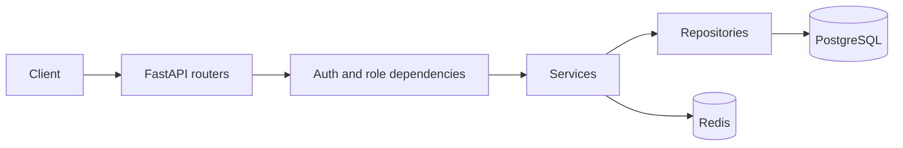

# FastAPI IAM

English | [Русский](README.ru.md)

FastAPI IAM is an asynchronous Identity and Access Management backend and starter
template built with FastAPI. It covers the account layer: registration and login,
JWT access tokens with rotating refresh sessions, user profiles and roles, session
management, and administrator-driven bans. It is a ready-to-extend template for
projects that need authentication, roles, sessions, and moderation.

**Contents:** [Features](#features) · [Tech stack](#tech-stack) · [Quick start](#quick-start) · [Requirements](#requirements) · [Local development](#local-development) · [Configuration](#configuration) · [Architecture](#architecture) · [API](#api) · [Tests](#tests) · [CI](#ci) · [Production](#production) · [Project structure](#project-structure) · [Limitations](#limitations) · [Troubleshooting](#troubleshooting) · [License](#license)

## Features

**Authentication and sessions.** Registration/login with bcrypt; short-lived JWT
access tokens sent as Bearer tokens, and rotating refresh tokens in an `HttpOnly`
cookie; Redis-backed sessions (IP, user agent, location, timestamps) with listing,
logout, logout-all, and UUID revocation; sensitive actions require a 24-hour-old
session; per-endpoint rate limits use Redis.

**Users and roles.** Profile, paginated/filterable user list, profile/password
updates, and deletion. Roles: `user` (10), `moderator` (30), `admin` (50); only
admins change roles. Users manage themselves, admins manage non-admin accounts.

**Moderation.** Admin-only ban/unban/history; bans have a reason and optional
expiry; banning invalidates all target sessions; every authenticated request
checks a Redis-cached active ban; admins cannot ban admins.

**Platform.** First admin bootstrapped from env; unified JSON errors for
validation, limits, Redis/DB outages, and unexpected failures; CORS, Loguru
logging, optional GeoIP, integration tests, CI.

## Tech stack

| Layer | Technology | Purpose |
| --- | --- | --- |
| Language | Python 3.14 | Runtime in Docker and CI |
| Web | FastAPI, Uvicorn | HTTP API and ASGI server |
| Validation | Pydantic 2, pydantic-settings | Schemas and environment settings |
| Data | SQLModel, SQLAlchemy 2 async, asyncpg | ORM and async PostgreSQL access |
| Database | PostgreSQL 18 | Data storage |
| Migrations | Alembic, alembic-postgresql-enum | Schema and enum migrations |
| State | Redis 8 | Sessions, rate-limit counters, ban cache |
| Security | PyJWT, bcrypt | Access tokens and password hashing |
| Rate limiting | slowapi | Per-endpoint limits backed by Redis |
| GeoIP | geoip2, user-agents | Session location and client metadata |
| Infrastructure | Docker, Docker Compose | Local dependencies and containerized app |
| Testing | pytest, pytest-asyncio, httpx, asgi-lifespan, Faker, freezegun, dirty-equals | Async integration tests and fixtures |
| Quality | Ruff (`ruff check`) | Linting in CI |

## Quick start

From the repository root:

```powershell
docker compose -f compose.dev.yml --env-file .env.dev up -d --wait
python -m venv .venv
.venv\Scripts\Activate.ps1        # Windows PowerShell
pip install -r requirements.txt
python scripts/migrate.py .env.dev
uvicorn src.main:app --env-file .env.dev --reload --port 8000
```

On Linux/macOS, use `source .venv/bin/activate`. Open
<http://localhost:8000/docs>. See [Local development](#local-development) for
details and [Configuration](#configuration) for environment files.

## Requirements

- Git and Docker with Docker Compose v2.
- Python 3.14 if you run the application outside Docker.
- Free ports: `8000` for the app, `5430`/`6377` for development PostgreSQL and
  Redis, `5431`/`6378` for test services.
- Optional: MaxMind `GeoLite2-City.mmdb` in the repository root. Without it the
  app logs a warning and uses `location = "Unknown"`.
- Network access to pull images and install Python packages.

## Local development

Development Compose starts only PostgreSQL and Redis. FastAPI runs on the host
through Uvicorn using `.env.dev`.

1. Clone the repository and enter its root:

   ```bash
   git clone <repository-url>
   cd fastapi-iam
   ```

2. Start development dependencies (`dev_postgres` on `5430`, `dev_redis` on
   `6377`):

   ```bash
   docker compose -f compose.dev.yml --env-file .env.dev up -d --wait
   ```

3. Create and activate a Python 3.14 virtual environment, then install
   dependencies:

   ```powershell
   python -m venv .venv
   .venv\Scripts\Activate.ps1        # Windows PowerShell
   # source .venv/bin/activate        # Linux/macOS
   pip install -r requirements.txt
   ```

4. Apply migrations (`scripts/migrate.py` passes `ENV_FILE=.env.dev` to Alembic;
   without an argument it also defaults to `.env.dev`):

   ```bash
   python scripts/migrate.py .env.dev
   ```

5. Start the API in reload mode:

   ```powershell
   uvicorn src.main:app --env-file .env.dev --reload --port 8000
   ```

6. Check `/docs`, `/redoc`, and `/openapi.json` on `localhost:8000`.

At startup FastAPI IAM creates an administrator only if none exists. Local
credentials come from `.env.dev` (`admin` / `admin`); change them outside local
development. Place `GeoLite2-City.mmdb` in the repository root to enable GeoIP.

## Configuration

Settings are read by `pydantic-settings` from the file selected by `ENV_FILE`
(default `.env`). Unknown variables are rejected.

| Variable | Required | Default | Purpose |
| --- | --- | --- | --- |
| `POSTGRES_USER` | yes | — | PostgreSQL user |
| `POSTGRES_PASSWORD` | yes | — | PostgreSQL password |
| `POSTGRES_DB` | yes | — | PostgreSQL database |
| `POSTGRES_HOST` | no | `localhost` | PostgreSQL host |
| `POSTGRES_PORT` | no | `5432` | PostgreSQL port |
| `REDIS_HOST` | no | `localhost` | Redis host |
| `REDIS_PORT` | no | `6379` | Redis port |
| `REDIS_PASSWORD` | yes | — | Redis password, also used by the rate limiter |
| `FIRST_ADMIN_DEFAULT_NAME` | no | `Admin` | First administrator's display name |
| `FIRST_ADMIN_DEFAULT_USER_NAME` | no | `admin` | First administrator's username |
| `FIRST_ADMIN_DEFAULT_PASSWORD` | yes | — | First administrator's password |
| `HTTPS` | no | `false` | Adds `Secure` to the refresh cookie |
| `CORS_ALLOWED_ORIGINS` | yes | — | JSON array, e.g. `["http://localhost:3000"]` |
| `JWT_TOKEN_KEY` | yes | — | HMAC key for access tokens |
| `JWT_EXPIRES_TIME` | no | `600` | Access-token lifetime, seconds |
| `JWT_ALGORITHM` | no | `HS256` | JWT signing algorithm |
| `REFRESH_TOKEN_KEY` | yes | — | HMAC key for refresh-token hashes |
| `REFRESH_EXPIRES_TIME` | no | `604800` | Refresh-session lifetime, seconds |

| File | Purpose | Committed |
| --- | --- | --- |
| `.env.example` | Template for production or a custom setup | yes |
| `.env.dev` | Development: `DevIAM`, ports `5430`/`6377` | yes |
| `.env.test` | Tests: `TestIAM`, ports `5431`/`6378` | yes |
| `.env` | Default settings; production values go here | no |

Committed `.env.dev` and `.env.test` contain disposable local credentials only.
Do not reuse them in production or commit production secrets.

## Architecture

Request flow: **routers** (`src/app/routes`) declare endpoints and limits;
**dependencies** (`src/app/utils/dependencies.py`) validate the JWT, load the
user, enforce roles, check session age, and reject bans; **services**
(`src/app/services`) hold business logic; **repositories**
(`src/app/repositories`) encapsulate database and Redis access. PostgreSQL stores
users and bans; Redis stores sessions, refresh-token mappings, rate-limit
counters, and the active-ban cache.



**Authentication.** The access token is a JWT with `sub` and `exp` (10 minutes by
default), sent as a Bearer token. The refresh token is a random URL-safe value in
an `HttpOnly`, `SameSite=Lax` cookie; Redis stores its HMAC-SHA256 hash, not the
raw value. Each refresh rotates the token while keeping the session UUID and
`created_at`. Session records include IP, user agent, location, creation time, and
last activity. Sensitive actions require a session older than 24 hours. Bans are
checked on every authenticated request, cached for up to 5 minutes, and banning
deletes all user sessions.

**Migrations and startup.** Alembic reads the database URL from settings and runs
async migrations from `src/migrations`; `alembic-postgresql-enum` handles enum
changes. The FastAPI lifespan creates the Redis client, loads optional GeoIP, and
bootstraps the first administrator; shutdown closes the GeoIP reader, Redis, and
database engine.

## API

Interactive docs: `/docs` (Swagger UI), `/redoc`, and `/openapi.json`. All
application routes are under `/api/v1`.

| Group | Key routes | Access |
| --- | --- | --- |
| Auth | `POST /auth/register`, `/auth/login`, `/auth/refresh` | Public; refresh needs the cookie |
| Users | `GET /users/me`, `GET /users/`, `GET /users/{user_id}`, `PATCH /users/{user_id}`, `PATCH /users/{user_id}/password`, `PATCH /users/{user_id}/role`, `DELETE /users/{user_id}` | Authenticated; role changes are admin-only |
| Sessions | `GET /sessions/`, `POST /sessions/logout`, `POST /sessions/logout-all`, `DELETE /sessions/revoke/{session_uuid}` | Authenticated; refresh cookie required |
| Bans | `POST /bans/users`, `GET /bans/users/{user_id}`, `DELETE /bans/users/{user_id}` | Administrator only |

- `register` is limited to 3 requests/minute, `login` to 5, and `refresh` to 3.
  Rate-limit failures return `429` with `Retry-After`.
- `GET /users/` supports `page`, `limit`, `name`, and `user_name`.
- Profile/password updates and account deletion are allowed for the owner or an
  administrator; administrators cannot modify another administrator.
- Profile/password updates, deletion, logout-all, and session revocation require
  a session at least 24 hours old.
- Administrators cannot be banned; bans are administrator-only.

## Tests

Tests are async integration tests using `httpx.ASGITransport`; no running API
server is needed, but PostgreSQL and Redis are required.

```bash
docker compose -f compose.test.yml --env-file .env.test up -d --wait
python -m pytest -q                                    # all tests
python -m pytest tests/test_auth.py -q                 # one file
python -m pytest tests/test_auth.py::test_name -q      # one test
docker compose -f compose.test.yml --env-file .env.test down -v
```

Isolation: `tests/conftest.py` sets `ENV_FILE=.env.test` before importing the app;
test containers use a separate database (`TestIAM`) and ports (`5431`/`6378`);
a session-scoped fixture applies migrations; after each test the suite truncates
`users` with `CASCADE` and runs `FLUSHDB` on Redis. Tests do not start containers
themselves. Never point `.env.test` at a shared development or production
database.

## CI

`.github/workflows/ci.yml` runs on pushes and pull requests to `main`, cancelling
in-progress runs for the same ref. **Lint** runs `ruff check --output-format=github`.
**Tests** installs dependencies on Python 3.14, starts `compose.test.yml` with
`.env.test`, runs `python -m pytest -q`, and always removes the test services with
`down -v`. There is no formatter check, type checker, or continuous deployment.

## Production

`compose.yml` contains only `migrate` and `app`; PostgreSQL and Redis are external.

1. Build the image: `docker build -t fastapi-iam:local .`
2. Create `.env` with external `POSTGRES_*`/`REDIS_*`, random `JWT_TOKEN_KEY` and
   `REFRESH_TOKEN_KEY`, a non-default `FIRST_ADMIN_DEFAULT_PASSWORD`, a JSON
   `CORS_ALLOWED_ORIGINS`, and `HTTPS=true` when serving over HTTPS.
3. Use hostnames reachable from the container: `localhost` points to the app
   container; use `host.docker.internal` (configured in Compose) or the external
   service hostname.
4. Place `GeoLite2-City.mmdb` in the repository root or remove the read-only
   volume mount; without it session locations stay `Unknown`. A missing
   bind-mount source can be created as a directory, so remove the mount if unused.
5. Run `docker compose up -d`. `migrate` executes `alembic upgrade head` and must
   finish before `app` starts on port `8000`.

There is no `/health` endpoint; the Compose healthcheck requests
`/openapi.json`. TLS, a domain, and a reverse proxy are outside this repository.
Never commit production secrets: `.env` is ignored, and only `.env.example` plus
the disposable dev/test files are tracked.

## Project structure

```text
fastapi-iam/
├── src/
│   ├── main.py              # FastAPI app, lifespan, middleware
│   ├── app/                 # routes, services, repositories, models, schemas, utils
│   │                        # db.py, settings.py
│   └── migrations/          # Alembic environment and versions
├── tests/                   # Integration tests, fixtures, factories
├── scripts/migrate.py       # Migration helper with an explicit env file
├── compose.dev.yml          # Development PostgreSQL and Redis
├── compose.test.yml         # Isolated test PostgreSQL and Redis
├── compose.yml              # Production app and migration services
├── Dockerfile / requirements.txt / pyproject.toml
└── .github/workflows/ci.yml
```

## Limitations

- PostgreSQL is required; the schema uses PostgreSQL-specific enums.
- Redis is required for sessions, rate limiting, and ban caching.
- GeoIP depends on an external MaxMind database.

## Troubleshooting

**Missing settings.** The app reads `.env` by default. Set
`ENV_FILE=.env.dev` or create `.env` from `.env.example`, or run the API with
`--env-file your_env_file`.

**Ports in use.** Development uses `8000`, `5430`, `6377`; tests use `5431`,
`6378`. Stop conflicting services or change the ports in the env file.

**Database refused.** Start Compose with `--wait` and check that `POSTGRES_HOST`
and `POSTGRES_PORT` match the published ports. Inside a container, do not use
`localhost` for host services.

**GeoIP unavailable.** Expected without `GeoLite2-City.mmdb`; add it to the
repository root to enable location lookup.

**401 after a while.** Access tokens expire after 10 minutes by default; call
`POST /api/v1/auth/refresh` with the refresh cookie.

**403 `SESSION_TOO_EARLY`.** Sensitive actions require a session at least 24
hours old.

**Cookies or CORS fail.** `CORS_ALLOWED_ORIGINS` must be a JSON array of exact
trusted origins; with `HTTPS=true` the refresh cookie is only sent over HTTPS.

**Tests used the wrong database.** Ensure `ENV_FILE=.env.test`, start
`compose.test.yml`, and verify ports `5431`/`6378`.

## License

This project is distributed under the MIT License. See [LICENSE](LICENSE) for
the full text.
