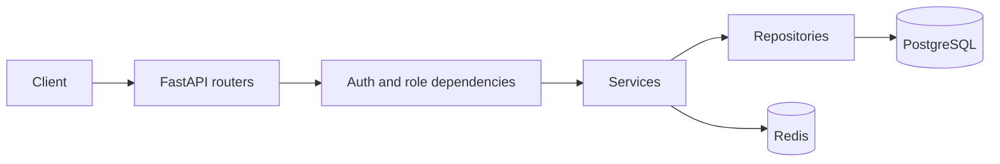

# FastAPI IAM

[English](README.md) | Русский

FastAPI IAM — асинхронный backend для Identity and Access Management (IAM) на
FastAPI и шаблон для быстрого старта. Сейчас проект закрывает аккаунтную часть:
регистрацию и вход, JWT access-токены с ротацией refresh-сессий, профили и роли
пользователей, управление сессиями и баны от администратора. Это готовый к
расширению шаблон: аутентификация, роли, сессии и модерация уже реализованы, а
прикладную логику можно добавлять поверх.

**Содержание:** [Возможности](#возможности) · [Технологический стек](#технологический-стек) · [Быстрый старт](#быстрый-старт) · [Требования](#требования) · [Локальная разработка](#локальная-разработка) · [Конфигурация](#конфигурация) · [Архитектура](#архитектура) · [API](#api) · [Тесты](#тесты) · [CI](#ci) · [Production](#production) · [Структура проекта](#структура-проекта) · [Ограничения](#ограничения) · [Устранение неполадок](#устранение-неполадок) · [Лицензия](#лицензия)

## Возможности

**Аутентификация и сессии.** Регистрация/вход с bcrypt; короткоживущие JWT
access-токены в Bearer-заголовке и ротация refresh-токенов в `HttpOnly`-cookie;
сессии в Redis (IP, user agent, геолокация, время) со списком, logout, logout-all
и отзывом по UUID; чувствительные действия требуют сессию старше 24 часов;
лимиты запросов хранятся в Redis.

**Пользователи и роли.** Профиль, постраничный список с фильтрами, изменение
профиля/пароля и удаление. Роли: `user` (10), `moderator` (30), `admin` (50);
роли меняет только admin. Пользователь управляет своим аккаунтом, admin —
не-admin аккаунтами.

**Модерация.** Бан/разбан/история только для admin; у бана есть причина и
необязательный срок; бан инвалидирует все сессии пользователя; каждый
авторизованный запрос проверяет кешированный в Redis активный бан; забанить
admin нельзя.

**Платформа.** Первый admin создаётся из env; единый JSON-формат ошибок для
валидации, лимитов, недоступности Redis/БД и непредвиденных сбоев; CORS, логи
Loguru, опциональный GeoIP, интеграционные тесты, CI.

## Технологический стек

| Слой | Технологии | Назначение |
| --- | --- | --- |
| Язык | Python 3.14 | Runtime в Docker и CI |
| Web | FastAPI, Uvicorn | HTTP API и ASGI-сервер |
| Валидация | Pydantic 2, pydantic-settings | Схемы и настройки окружения |
| Данные | SQLModel, SQLAlchemy 2 async, asyncpg | ORM и асинхронный PostgreSQL |
| База данных | PostgreSQL 18 | Хранение данных |
| Миграции | Alembic, alembic-postgresql-enum | Миграции схемы и enum |
| Состояние | Redis 8 | Сессии, счётчики rate limit, кеш банов |
| Безопасность | PyJWT, bcrypt | Access-токены и хеширование паролей |
| Rate limiting | slowapi | Лимиты на эндпоинтах с хранением в Redis |
| GeoIP | geoip2, user-agents | Геолокация и метаданные клиента |
| Инфраструктура | Docker, Docker Compose | Локальные зависимости и приложение |
| Тестирование | pytest, pytest-asyncio, httpx, asgi-lifespan, Faker, freezegun, dirty-equals | Асинхронные интеграционные тесты |
| Качество | Ruff (`ruff check`) | Линтинг в CI |

## Быстрый старт

Из корня репозитория:

```powershell
docker compose -f compose.dev.yml --env-file .env.dev up -d --wait
python -m venv .venv
.venv\Scripts\Activate.ps1        # Windows PowerShell
pip install -r requirements.txt
python scripts/migrate.py .env.dev
uvicorn src.main:app --env-file .env.dev --reload --port 8000
```

На Linux/macOS используйте `source .venv/bin/activate`. Swagger UI:
<http://localhost:8000/docs>. Подробности — в разделе
[Локальная разработка](#локальная-разработка), переменные — в разделе
[Конфигурация](#конфигурация).

## Требования

- Git и Docker с Docker Compose v2.
- Python 3.14, если приложение запускается вне Docker.
- Свободные порты: `8000` для приложения, `5430`/`6377` для development
  PostgreSQL и Redis, `5431`/`6378` для тестовых сервисов.
- Опционально: MaxMind `GeoLite2-City.mmdb` в корне репозитория. Без неё
  приложение пишет warning и использует `location = "Unknown"`.
- Доступ в сеть для скачивания Docker-образов и Python-пакетов.

## Локальная разработка

Development Compose поднимает только PostgreSQL и Redis. FastAPI запускается на
хосте через Uvicorn и читает `.env.dev`.

1. Клонируйте репозиторий и перейдите в его корень:

   ```bash
   git clone <repository-url>
   cd fastapi-iam
   ```

2. Запустите зависимости (`dev_postgres` на `5430`, `dev_redis` на `6377`):

   ```bash
   docker compose -f compose.dev.yml --env-file .env.dev up -d --wait
   ```

3. Создайте виртуальное окружение Python 3.14, активируйте его и установите
   зависимости:

   ```powershell
   python -m venv .venv
   .venv\Scripts\Activate.ps1        # Windows PowerShell
   # source .venv/bin/activate        # Linux/macOS
   pip install -r requirements.txt
   ```

4. Примените миграции (`scripts/migrate.py` передаёт в Alembic
   `ENV_FILE=.env.dev`; без аргумента он также использует `.env.dev`):

   ```bash
   python scripts/migrate.py .env.dev
   ```

5. Запустите API в режиме reload:

   ```powershell
   uvicorn src.main:app --env-file .env.dev --reload --port 8000
   ```

6. Проверьте `/docs`, `/redoc` и `/openapi.json` на `localhost:8000`.

При старте FastAPI IAM создаёт администратора, только если администраторов ещё нет.
Локальные учётные данные берутся из `.env.dev` (`admin` / `admin`); смените их
вне локальной разработки. Положите `GeoLite2-City.mmdb` в корень репозитория,
чтобы включить GeoIP.

## Конфигурация

Настройки читает `pydantic-settings` из файла, выбранного через `ENV_FILE`
(по умолчанию `.env`). Неизвестные переменные отклоняются.

| Переменная | Обязательна | По умолчанию | Назначение |
| --- | --- | --- | --- |
| `POSTGRES_USER` | да | — | Пользователь PostgreSQL |
| `POSTGRES_PASSWORD` | да | — | Пароль PostgreSQL |
| `POSTGRES_DB` | да | — | База данных PostgreSQL |
| `POSTGRES_HOST` | нет | `localhost` | Хост PostgreSQL |
| `POSTGRES_PORT` | нет | `5432` | Порт PostgreSQL |
| `REDIS_HOST` | нет | `localhost` | Хост Redis |
| `REDIS_PORT` | нет | `6379` | Порт Redis |
| `REDIS_PASSWORD` | да | — | Пароль Redis, используется и rate limiter |
| `FIRST_ADMIN_DEFAULT_NAME` | нет | `Admin` | Имя первого администратора |
| `FIRST_ADMIN_DEFAULT_USER_NAME` | нет | `admin` | Username первого администратора |
| `FIRST_ADMIN_DEFAULT_PASSWORD` | да | — | Пароль первого администратора |
| `HTTPS` | нет | `false` | Добавляет `Secure` refresh-cookie |
| `CORS_ALLOWED_ORIGINS` | да | — | JSON-массив, например `["http://localhost:3000"]` |
| `JWT_TOKEN_KEY` | да | — | HMAC-ключ access-токенов |
| `JWT_EXPIRES_TIME` | нет | `600` | Время жизни access-токена, секунды |
| `JWT_ALGORITHM` | нет | `HS256` | Алгоритм подписи JWT |
| `REFRESH_TOKEN_KEY` | да | — | HMAC-ключ хешей refresh-токенов |
| `REFRESH_EXPIRES_TIME` | нет | `604800` | Время жизни refresh-сессии, секунды |

| Файл | Назначение | В репозитории |
| --- | --- | --- |
| `.env.example` | Шаблон для production или своей конфигурации | да |
| `.env.dev` | Development: `DevIAM`, порты `5430`/`6377` | да |
| `.env.test` | Тесты: `TestIAM`, порты `5431`/`6378` | да |
| `.env` | Настройки по умолчанию; сюда кладутся production-значения | нет |

В закоммиченных `.env.dev` и `.env.test` только одноразовые локальные учётные
данные. Не используйте их в production и не коммитьте production-секреты.

## Архитектура

Поток запроса: **роутеры** (`src/app/routes`) объявляют эндпоинты и лимиты;
**зависимости** (`src/app/utils/dependencies.py`) проверяют JWT, загружают
пользователя, проверяют роль, возраст сессии и бан; **сервисы**
(`src/app/services`) содержат бизнес-логику; **репозитории**
(`src/app/repositories`) инкапсулируют доступ к БД и Redis. PostgreSQL хранит
пользователей и баны; Redis — сессии, соответствия refresh-токенов, счётчики
rate limit и кеш активных банов.



**Аутентификация.** Access-токен — JWT с `sub` и `exp` (по умолчанию 10 минут),
передаётся как Bearer-токен. Refresh-токен — случайное URL-safe значение в
`HttpOnly`-cookie с `SameSite=Lax`; Redis хранит его HMAC-SHA256-хеш, а не сам
токен. При каждом refresh токен ротируется, UUID сессии и `created_at`
сохраняются. Запись сессии включает IP, user agent, геолокацию, время создания и
last activity. Для чувствительных операций сессия должна быть старше 24 часов.
Баны проверяются на каждом авторизованном запросе, кешируются до 5 минут, а при
бане удаляются все сессии пользователя.

**Миграции и запуск.** Alembic берёт URL базы из настроек и выполняет
асинхронные миграции из `src/migrations`; `alembic-postgresql-enum` обрабатывает
enum. Lifespan FastAPI создаёт клиент Redis, загружает GeoIP и первого
администратора; при остановке закрываются GeoIP reader, Redis и движок БД.

## API

Документация: `/docs` (Swagger UI), `/redoc` и `/openapi.json`. Все прикладные
маршруты — под `/api/v1`.

| Группа | Основные маршруты | Доступ |
| --- | --- | --- |
| Auth | `POST /auth/register`, `/auth/login`, `/auth/refresh` | Публично; refresh требует cookie |
| Users | `GET /users/me`, `GET /users/`, `GET /users/{user_id}`, `PATCH /users/{user_id}`, `PATCH /users/{user_id}/password`, `PATCH /users/{user_id}/role`, `DELETE /users/{user_id}` | Авторизация; смена роли — только admin |
| Sessions | `GET /sessions/`, `POST /sessions/logout`, `POST /sessions/logout-all`, `DELETE /sessions/revoke/{session_uuid}` | Авторизация; нужна refresh-cookie |
| Bans | `POST /bans/users`, `GET /bans/users/{user_id}`, `DELETE /bans/users/{user_id}` | Только администратор |

- `register` — 3 запроса/минуту, `login` — 5, `refresh` — 3. При превышении
  возвращается `429` с `Retry-After`.
- `GET /users/` поддерживает `page`, `limit`, `name`, `user_name`.
- Профиль/пароль и удаление аккаунта доступны владельцу или администратору;
  администратор не может изменять другого администратора.
- Изменение профиля/пароля, удаление, logout-all и отзыв сессии требуют сессию
  старше 24 часов.
- Забанить администратора нельзя; баны доступны только администраторам.

## Тесты

Тесты — асинхронные интеграционные на `httpx.ASGITransport`; запущенный API не
нужен, но PostgreSQL и Redis обязательны.

```bash
docker compose -f compose.test.yml --env-file .env.test up -d --wait
python -m pytest -q                                    # все тесты
python -m pytest tests/test_auth.py -q                 # один файл
python -m pytest tests/test_auth.py::test_name -q      # один тест
docker compose -f compose.test.yml --env-file .env.test down -v
```

Изоляция: `tests/conftest.py` выставляет `ENV_FILE=.env.test` до импорта
приложения; тестовые контейнеры используют отдельную базу (`TestIAM`) и
порты (`5431`/`6378`); session-scoped фикстура применяет миграции; после каждого
теста выполняется `TRUNCATE users ... CASCADE` и `FLUSHDB` для Redis. Тесты сами
не поднимают контейнеры. Не направляйте `.env.test` на общую development- или
production-базу.

## CI

`.github/workflows/ci.yml` запускается на push и pull request в `main`, отменяя
предыдущие запуски для той же ветки. **Lint** выполняет
`ruff check --output-format=github`. **Tests** ставит зависимости на Python 3.14,
поднимает `compose.test.yml` с `.env.test`, запускает `python -m pytest -q` и
всегда удаляет тестовые сервисы через `down -v`. Проверки форматтера, type checker
и continuous deployment в CI нет.

## Production

`compose.yml` содержит только `migrate` и `app`; PostgreSQL и Redis — внешние.

1. Соберите образ: `docker build -t fastapi-iam:local .`
2. Создайте `.env` с внешними `POSTGRES_*`/`REDIS_*`, случайными
   `JWT_TOKEN_KEY` и `REFRESH_TOKEN_KEY`, нестандартным
   `FIRST_ADMIN_DEFAULT_PASSWORD`, JSON-массивом `CORS_ALLOWED_ORIGINS` и
   `HTTPS=true`, если приложение работает по HTTPS.
3. Используйте hostname, доступные из контейнера: `localhost` указывает на сам
   контейнер; для сервисов на Docker-хосте используйте `host.docker.internal`
   (настроен в Compose) или внешний hostname.
4. Положите `GeoLite2-City.mmdb` в корень репозитория или удалите read-only
   volume mount; без файла геолокация остаётся `Unknown`. Если источник
   bind-mount отсутствует, Docker может создать на его месте каталог, поэтому
   удалите mount, если GeoIP не нужен.
5. Выполните `docker compose up -d`. `migrate` запускает `alembic upgrade head` и
   должен завершиться до старта `app` на порту `8000`.

Отдельного `/health` нет; healthcheck Compose запрашивает `/openapi.json`. TLS,
домен и reverse proxy в репозиторий не входят. Не коммитьте production-секреты:
`.env` игнорируется, в репозитории только `.env.example` и одноразовые
dev/test-файлы.

## Структура проекта

```text
fastapi-iam/
├── src/
│   ├── main.py              # FastAPI app, lifespan, middleware
│   ├── app/                 # routes, services, repositories, models, schemas, utils
│   │                        # db.py, settings.py
│   └── migrations/          # Alembic environment и версии
├── tests/                   # Интеграционные тесты, фикстуры, фабрики
├── scripts/migrate.py       # Хелпер миграций с явным env-файлом
├── compose.dev.yml          # Development PostgreSQL и Redis
├── compose.test.yml         # Изолированные тестовые PostgreSQL и Redis
├── compose.yml              # Production app и migration services
├── Dockerfile / requirements.txt / pyproject.toml
└── .github/workflows/ci.yml
```

## Ограничения

- Требуется PostgreSQL; схема использует специфичные для PostgreSQL enum.
- Redis обязателен для сессий, rate limiting и кеша банов.
- Геолокация зависит от внешней базы MaxMind.

## Устранение неполадок

**Нет настроек.** Приложение читает `.env` по умолчанию. Задайте
`ENV_FILE=.env.dev` или создайте `.env` из `.env.example`, либо запускайте API с флагом `--env-file ваш_env_файл`.

**Порты заняты.** Development использует `8000`, `5430`, `6377`; тесты —
`5431`, `6378`. Остановите конфликтующие сервисы или измените порты в env-файле.

**База отклоняет соединение.** Запустите Compose с `--wait` и проверьте, что
`POSTGRES_HOST` и `POSTGRES_PORT` совпадают с опубликованными портами. Внутри
контейнера не используйте `localhost` для сервисов хоста.

**GeoIP недоступен.** Это ожидаемо без `GeoLite2-City.mmdb`; положите файл в
корень репозитория, чтобы включить геолокацию.

**401 через некоторое время.** Access-токен по умолчанию живёт 10 минут;
вызовите `POST /api/v1/auth/refresh` с refresh-cookie.

**403 `SESSION_TOO_EARLY`.** Чувствительные действия требуют сессию старше
24 часов.

**Не работают cookie или CORS.** `CORS_ALLOWED_ORIGINS` должен быть JSON-массивом
точных доверенных origins; при `HTTPS=true` refresh-cookie отправляется только
по HTTPS.

**Тесты затронули не ту базу.** Убедитесь, что задан `ENV_FILE=.env.test`,
запущен `compose.test.yml`, а порты — `5431`/`6378`.

## Лицензия

Проект распространяется под лицензией MIT. Полный текст — в файле
[LICENSE](LICENSE).
